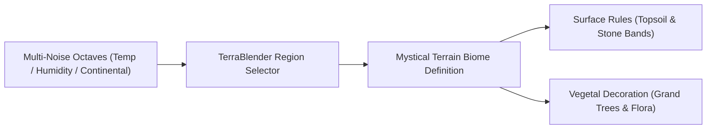

# Biomes Encyclopedia & TerraBlender Integration

Mystical Terrain delivers one of the most comprehensive procedural biome expansions in modern Minecraft, generating diverse terrestrial, subterranean, nether, and void ecosystems.

## 🌐 TerraBlender Architecture

All biome distributions are managed through data-driven **TerraBlender** regions. This architecture ensures harmonious blending with vanilla biomes and other major terrain mods without hardcoded world generation conflicts.

### Regional Configuration Files

- **`regions.json`**: Controls Overworld continental noise, erosion slices, and temperature/humidity coordinate mappings.
- **`surface_rules.json`**: Implements dynamic block layering, placing customized topsoil, foliage cover, gravel shelves, and shoreline transitions.
- **`nether_regions.json` & `nether_surface_rules.json`**: Reconfigures Nether ceiling/floor noise bands and cavernous lava pools.
- **`end_biomes.json`**: Injects void islands, starry spires, and astral flora into the outer End rings.

## 🗺️ Ecological Realm Divisions

Explore the distinct regional chapters:

- **[Overworld Sanctuaries](/biomes/overworld)**: Titan Peaks, Blossom Vale, Ancient Redwoods, Crystal Highlands, and Spire Karsts.
- **[Nether & The End Realms](/biomes/nether-end)**: Ember Wastes, Fungal Depths, Twilight Thickets, and Astral End Voids.
