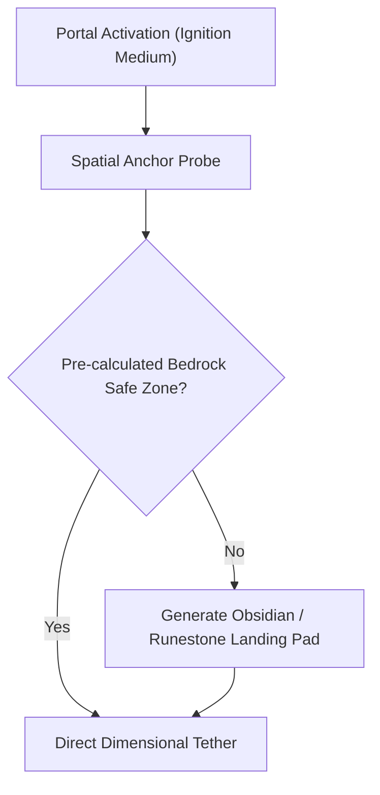

# Dimensional Portals & Spatial Anchoring

Mystical Terrain enhances vanilla inter-dimensional transport with **Spatial Anchors** and stabilized **Gateway Ignitions**, preventing broken coordinates and enabling clean transit between the Overworld, Nether, and The End.

---

## 🌀 Gateway Ignition Architecture

Standard portal travel in Minecraft frequently suffers from offset coordinate miscalculations or suffocation hazards when entering uncharted subterranean terrain. Mystical Terrain establishes a robust anchoring framework:

### Key Gateway Mechanics

1. **Pre-scanned Landing Volumes**: Portals avoid generating inside lava oceans or sealed cavern pockets by validating a $5 \times 5 \times 4$ clear bounding box before placing destination frames.
2. **End Void Tethering**: In The End, the central Exit Portal acts as a gravitational anchor. Void Pedestals broadcast coordinate telemetry directly to `EndDragonFightAccessor`, ensuring the dragon arena and return pathways never desync.
3. **Resonance Stabilization**: Portals ignited with celestial items (such as the *Eye of the Void* or *Starlight Vial*) emit reduced ambient portal rumble noise and display custom purple/cyan particulate shaders.

---

## 🧭 In-Game Dimensional Travel Tips

- **Anchor Coordinates**: Placing **Runestone Bricks** or **Moonstone Bricks** beneath your portal frame stabilizes the spatial signature, prioritizing your portal over nearby wild gateways.
- **Cross-Dimensional Boss Arenas**: When fighting the Void Dragon or Nether Sovereigns, gateway portals temporarily lock until the colossus is either defeated or dispelled via `/boss despawn`.
