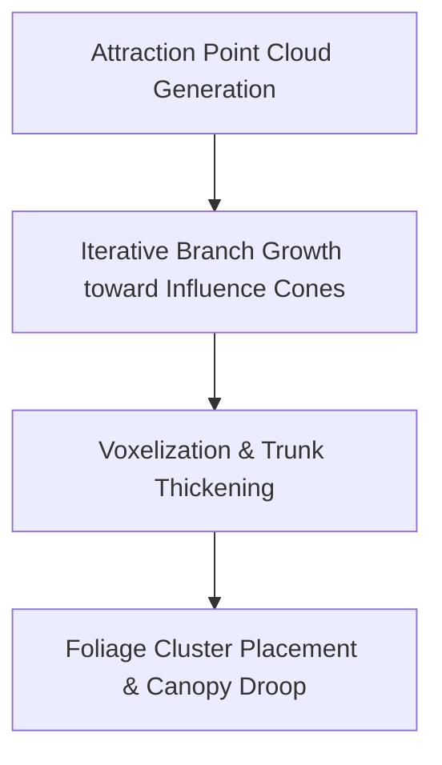

# Space-Colonization Procedural Trees

Mystical Terrain departs from traditional hardcoded voxel tree schematics by implementing **space-colonization mathematical algorithms**. Rather than repeating identical trunk patterns, every World Tree, Grand Tree, and canopy emerges organically based on environmental attraction points.

## 🌲 How the Algorithm Works

The procedural tree generation pipeline operates in three distinct phases during chunk `VEGETAL_DECORATION`:

1. **Attraction Point Cloud**: A 3D bounding volume above the seed root is seeded with randomized attraction points (nodes of light and moisture).
2. **Branch Vectoring**: Buds grow toward the closest attraction point within their angular influence cone. Once a bud approaches within the kill distance of an attraction point, that point is consumed.
3. **Trunk Thickening**: Based on the number of child branches supported, trunk radii expand proportionally toward the roots, producing realistic flares and buttresses.
4. **Foliage Clustered Canopies**: Foliage blobs are placed with weighted density shaders to generate cascading leaves and glowing floral lanterns.

## 🪵 Custom Wood & Tree Species

Mystical Terrain introduces over a dozen distinct arbor species, each featuring custom bark textures, stripped logs, planks, doors, fences, and slabs:

| Tree Species | Native Biome | Distinct Features | Wood Hue |
|---|---|---|---|
| **Charwood** | Ember Wastes & Basalt Ridges | Heat-resistant, smoldering grain, ember particles | Deep obsidian & charcoal |
| **Cypress** | Sunken Mires & River deltas | Tall tapering conical crown, hanging moss | Earthy sage green |
| **Ginkgo** | Amber Meadows & Golden Groves | Fan-shaped golden-yellow leaves, high canopies | Honey blonde |
| **Gloamwood** | Deep Hollows & Cavern Verge | Bioluminescent purple veins, fungal symbiosis | Midnight violet |
| **Maple** | Autumnal Hills & Maple Woods | Radiant crimson foliage, maple sap drops | Warm amber red |
| **Mystwood** | Arcane Forests & Blossom Vales | Prismatic wood grain, starlight leaves | Lavender & azure |
| **Olive** | Mediterranean Ridges & Plains | Twisted gnarled trunks, silver-green leaves | Pale olive-gray |
| **Palm** | Oasis & Tropic Beaches | Curved leaning trunks, tropical coconut crowns | Warm golden tan |
| **Rimewood** | Frostveil Glacier & Alpine Peaks | Glazed frost bark, icicle droplets | Pale glacial cyan |
| **Silverbark** | Lunar Sanctuaries & Crystal Highlands | Reflective silver wood, ethereal glimmer | Polished platinum |
| **Sporewood** | Fungal Depths & Spore Marshes | Spore puff clusters, spongy elastic bark | Toxic emerald |
| **Starbark** | High End Islands & Astral Spires | Cosmic particle emitters, celestial density | Starlit indigo |

## 🪓 Woodworking & Planks Crafting

All custom wood types follow standard vanilla carpentry progression. For example, processing **Charwood Logs**:

<MinecraftRecipe id="charwood_planks" />

<MinecraftRecipe id="charwood_stairs" />

<MinecraftRecipe id="charwood_door" />
